[TOC]

# Lernenden-zentriertes Lernen: SOL

---

### Lernziele:
* Wozu SOL im Unterricht?
* Welche Rollen gibt es und was sind Ressourcen?
* Einführung in die Begriffe, die beim SOL relevant sind.
* Einführung in den Selbst-Lern-Zyklus

---

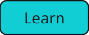

**Lehrerzentriertes Lernen**: Ist ein Führungsstil und eine Form des Unterrichts, bei denen alle wesentlichen Impulse, Aktionen und Entscheidungen von dem Lehrer oder der Lehrerin ausgehen: (Didaktisches Dreieck im Schulzimmer)

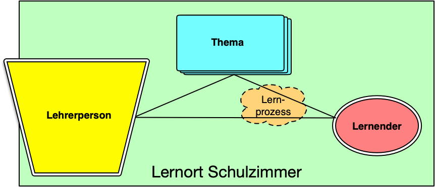

Wenn Lernende bei vorgegebenen Inhalten und Zielen ihr eigenes Lernen selbst steuern und Entscheidungen über die Art und Weise ihrer Lernorganisation fällen, so spricht man vom **selbstorganisierten Lernen**, sprich "**SOL**". (Verwandte Lernsettings sind *Projektlernen* oder *Werkstattlernen*.)

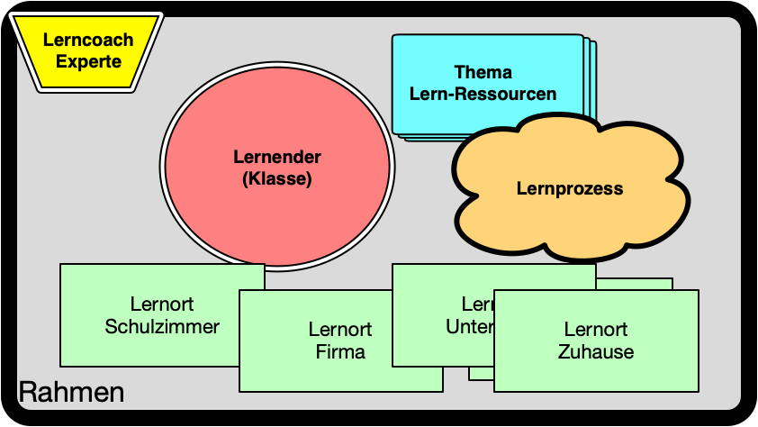
Innerhalb des vorgegebenen Rahmens ist individuelles Lernen möglich.

## Wozu?

Die Anforderungen der Wirtschaft für neue Berufsleute haben sich gegenüber der Vergangenheit geändert. Die Lehr- und Lernformen müssen sich auch anpassen und neben den **Fachkompetenzen** (Wissen etc.) müssen auch **überfachliche Kompetenzen** mit einbezogen und trainiert werden.

## Rollen

* Der Lernende wird zum "**Entdecker**", der seinen eigenen **Lernprozess** steuert. Der Lernende arbeitet in einem **Tandem-Team**, d.h. jede(r) hat einen Partner(in).
* Die Lehrperson wird zum "**Coach**", die den Lernprozess begleitet.
* Die Lehrperson wird zum "**Experten**", die **Kompetenzen** abnimmt.

## Ressourcen (Quellen)
* Die **zentrale Plattform** (Miro) dient als Drehscheibe für Kommunikation, Planung, Austausch.
*Die Ziele sind in einem **Kompetenzraster** formuliert und indiziert.
* **Lern-Ressourcen** dazu (Inputs, Unterlagen, Übungen, etc) sind online (GitLAB, MS-Stream, YT, etc.) verfügbar und referenziert.
* Das **Vorwissen** des Lernenden.
* Das Wissen der Klasse soll in **Kooperation** genutzt werden können.

---

# Begriffe:

## Kompetenz:
Gemeint ist die Fähigkeit und Fertigkeit, in den genannten Gebieten Probleme zu lösen, sowie die Bereitschaft, dies auch zu tun.
Im Allgemeinen sind sachlich-kategoriale, methodische und selbststeuernde Elemente verknüpft, einschließlich ihrer Anwendung auf ganz unterschiedliche Gegenstände.
-> Umgangssprachlich: „Jemand ist kompetent“ 

 KURZ:  **= Wissen + Können + Anwenden**

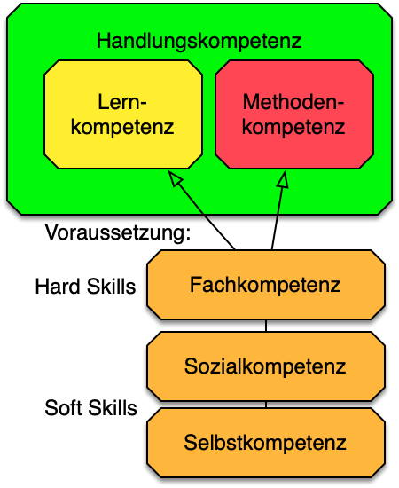

### Handlungskompetenz:
„Handlungskompetenz wird verstanden als die Bereitschaft und Befähigung des Einzelnen, sich in beruflichen, gesellschaftlichen und privaten Situationen sachgerecht durchdacht sowie individuell und sozial verantwortlich zu verhalten.“ 
Beinhaltet Lern- und Methodenkompetenz, die wiederum als Voraussetzung Fach-, Sozial- und Selbstkompetenz haben!

### Handlungsziel
Messbaren Beschreibung eines Zustandes und/oder Produkts.
Zur Erreichung dieses Ziels müssen aktive Handlungen ausgeführt werden, die durch verschiedenen Kompetenzbereiche charakterisiert werden können.

Handlungsziele werden oft beschreibend formuliert: „Ich kann ...“, „Ich habe ...angewandt“, „Ich weiss ... „

### Kompetenzraster
Ein Raster mit in Kompetenzfelder eingeteilte Handlungsziele. 

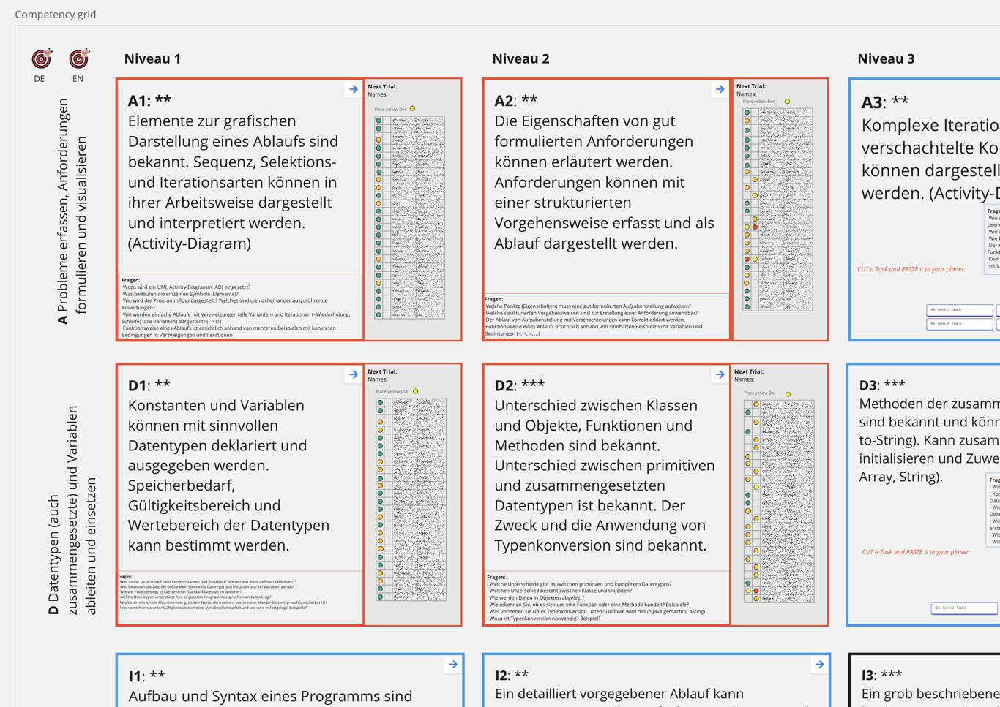

**Zweck des Kompetenzrasters:**

* Zielformulierung für selbstorganisiertes Lernen
* Inhaltsbestimmung für Lernsequenzen
* Orientierungshilfe zur Lernstrategieentwicklung (Offene Fragen)
* Vorgaben zur Lernzielkontrolle 

Einteilung in Fachgebiet, Themenbereiche, Schwierigkeitsgrad, Aufwand, Zeitbedarf, Wissensstand, etc. möglich.

Jedes erfolgreich abgeschlossene Kompetenzfeld ergibt summierte Punkte, um am Ende eine abschliessende Note zu evaluieren.

### Lern- und Nachweis-Portfolio

Ein "Portfolio" ist eine Sammlung von "**Daten und Informationen**", die aufgrund des Lernprozesses entstanden (**Urheberrecht**!) oder relevant sind. 

Wir unterscheiden das Lern-Portfolio und das Nachweisportfolio

1. **Lern-Portfolio**  
Siehe [Lern-Portfolio](../N0-Portfolio/README.md). In der Praxis wird ein "**persönliches**", digitales Tool verwendet: OneNote, EverNote, Confluence, Miro, GitLAB, ... oder ein LMS. Die Lehrperson erhält einen Link mit Schreibrechten.

2. **Nachweis-Portfolio**  
In der Regel eine **strukturierte Ablage** wie Sharepoint oder GitLAB. Die Lehrperson erhält einen Link mit Schreibrechten.

### Kompetenznachweis und Beleg
1. Handlung, bei der eine Lernzielkontrolle durchgeführt wird, um die geforderten Handlungskompetenzen nachzuweisen. 
&#8594; Fachgespräch, Demonstration, Präsentation, Cast anhand eines "**Belegs**" (&#8594; Datei)!
2. Bestätigung, dass die geforderten Handlungskompetenzen ausgewiesen sind! D.h. der Beleg ist im Nachweis-Portfolio abgelegt und im **Punkteraster** als **PASS** markiert!

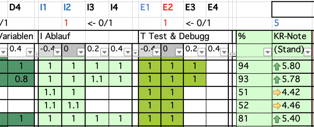

---

## Der Selbst-Lern-Zyklus

Im Unterricht sind Sie als Lernender **EntdeckerIn** und **OrganisatorIn** Ihres eigenen Lernprozesses. Folgendes Diagramm gibt eine empfohlene Lernstrategie vor:
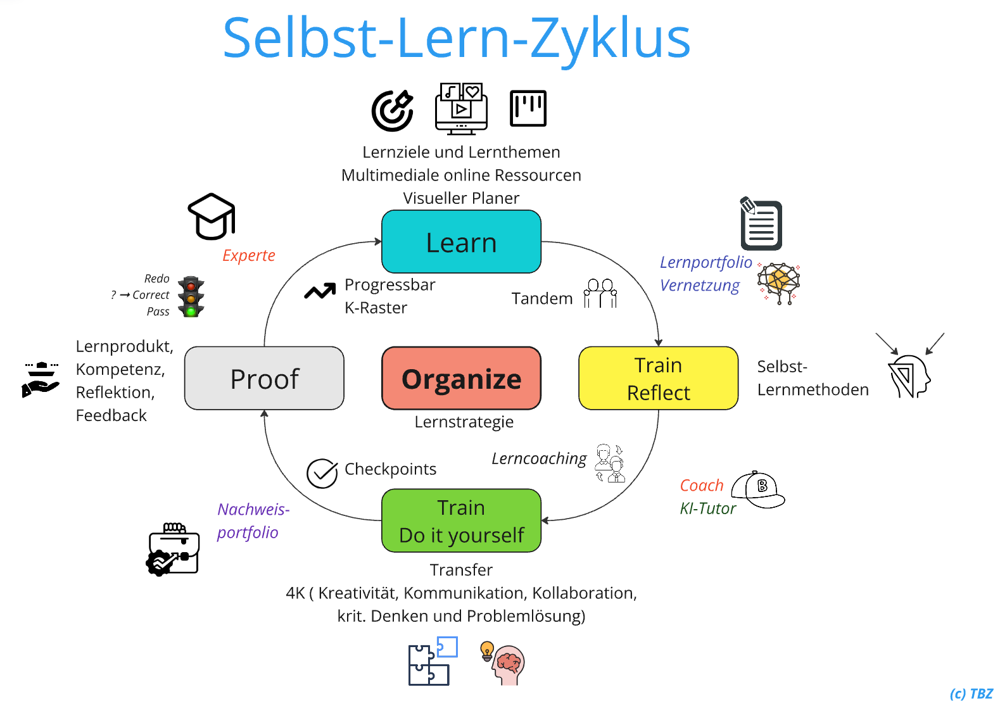  

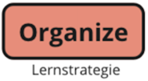 

**ORGANIZE:** Alle folgenden Schritte des Lernzykluses sind entsprechend zu organisieren! Z.Bsp.:

- Unterlagen und weitere Ressourcen auf GitLAB
- Weitere individuelle Ressourcen und Szenarios erzeugt durch KI
- Evtl. visuelle Learnmap mit Avatar oder Dots
- [KANBAN](https://gitlab.com/ch-tbz-it/Stud/allgemein/kanban) Planer
- Anmelden Kompetenznachweis (Gespräche, Demo, Kolloquium &rarr; je nach Modulvorgaben)

 

**LEARN:**

- Bestimmen Sie das nächste zu lernende Thema. (➞ Learnmap, Kompetenzraster) 
- Verschaffen Sie sich einen Überblick über alle dazugehörigen Ressourcen. (➞ GitLAB)
- Arbeiten Sie sich ins Thema ein - durch Lesen und Schauen der Lernvideos (➞ Stream)
- Nachmachen: Soweit möglich testen Sie die vorgestellten Praktiken selber aus.
- Notieren  Sie die neuen Erkenntnisse ins *Lern-Portfolio* &rarr; Bilder kopieren und kommentieren

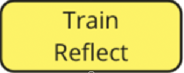

**TRAIN & REFLECT:** Wenden Sie aktive Lernmethoden an, um das Aufgenommene zu verarbeiten:

- Lassen Sie sich von eines *KI-Tutors im Lernmodus* (Study-Mode) die einzelnen Themen allenfalls nochmal erklären. [&rarr; KI-Kompetenz](https://gitlab.com/ch-tbz-it/Stud/allgemein/ki-kompetenz)
- Vernetzen Sie die Notizen in Ihrem *Lern-Portfolio*. (➞ Formatieren, Niederschreiben, Kommentieren, Vernetzen) 
- Erstellen Sie Fragen zum Thema anhand der Einträge in Ihrem *Lern-Portfolios*. (➞ Active Recall)
- Beantworten Sie gegenseitig Ihre Fragen im Tandem. (➞ Lernlücken? Neue Erkenntnisse?)

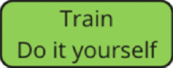 

**TRAIN - DoItYourself:** 

- Versuchen Sie anhand des Erlernten eigene Beispiele, z.B. aus ihrer Berufspraxis, umzusetzen. Variieren, ergänzen, kombinieren Sie ... seien Sie kreativ! 
- Suchen Sie mit deinem *KI-Tutor Szenarios* zu erzeugen, die ihnen eine Vertiefung der Thematik erlauben.
- Evtl. finden Sie nun konkrete Probleme, welche Sie nun selbstständig lösen sollten. [&rarr; KI-Kompetenz](https://gitlab.com/ch-tbz-it/Stud/allgemein/ki-kompetenz)
- Tauschen Sie im Tandem oder mit anderen Lerngruppen über ihre Erkenntnisse aus und arbeiten Sie gemeinsam an aufkommenden Hindernissen. (➞ 4K).
- Reflektieren Sie ihre Erkenntnisse, indem Sie die KI bitten, ihnen ein differenziertes Feedback zu geben.
- Gehen Sie die offenen Fragen der Checkpoints durch und beantworten Sie diese im *Lern-Portfolio*.

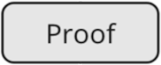 

**PROOF:** Nun schliessen Sie eine "Lernschleife" mit dem Kompetenznachweis ab. 

- Legen Sie dazu alle nötigen Belege und Produkte im *Nachweis-Portfolio* zur Einsicht ab. 
- Die Lehrperson wird ihre *Kompetenz* als Experte *sicherstellen*: 
  - durch Sichtung ihres Lernprodukts
  - durch Präsentation ihrer Eigenleistung, ihrer Kompetenz
  - durch Fachgespräch oder Reflektion
  - durch ihr Feedback innerhalb des Tandems
  - ...
- Bei *ungenügendem Nachweis* wird der Experte Ergänzungen einfordern.
- Evtl. ergänzen Sie Ihr *Lern-Portfolio* mit den beim Nachweis erworbenen Erkenntnissen.
- Besprechen Sie mit der Lehrperson die nächsten geplanten Schritte. (➞ Kompetenzraster)

---

&#8594; [Learning Rules](./SOL_Learning_Rules.md)

---

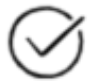

# CheckPoint
* Was ist ein **Tandem**?
* Aus welchen Kompetenzen bildet sich die **Handlungskompetenz**?
* Was ist der **Unterschied** zwischen einem Lern- und einem Nachweis-**Portfolio**?
* Was ist ein **Beleg** und wozu wird er verwendet?
* Wann ist ein **Nachweis** abgenommen?
* Ich verstehe den **Selbst-Lern-Zyklus** und meine Eigenverantwortung darin.
* Ich kenne die einzelnen Phasen des Selbst-Lern-Zyklus und weiss was meine Aufgabe darin ist.
* Welche **Regeln** gelten im Schulzimmer?

---

### Selbst-Lern-Zyklus für Lehrpersonen:
 45min [--> Intro_Video](https://tbzedu-my.sharepoint.com/:v:/g/personal/michael_kellenberger_tbz_ch/EdF8QWGZ6-5EuGYkUSy2tiABVdnP7yT6WepapSnxgVFf6Q?nav=eyJyZWZlcnJhbEluZm8iOnsicmVmZXJyYWxBcHAiOiJPbmVEcml2ZUZvckJ1c2luZXNzIiwicmVmZXJyYWxBcHBQbGF0Zm9ybSI6IldlYiIsInJlZmVycmFsTW9kZSI6InZpZXciLCJyZWZlcnJhbFZpZXciOiJNeUZpbGVzTGlua0NvcHkifX0&e=nHS34H)