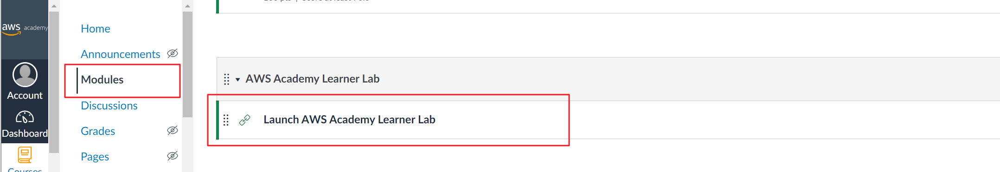
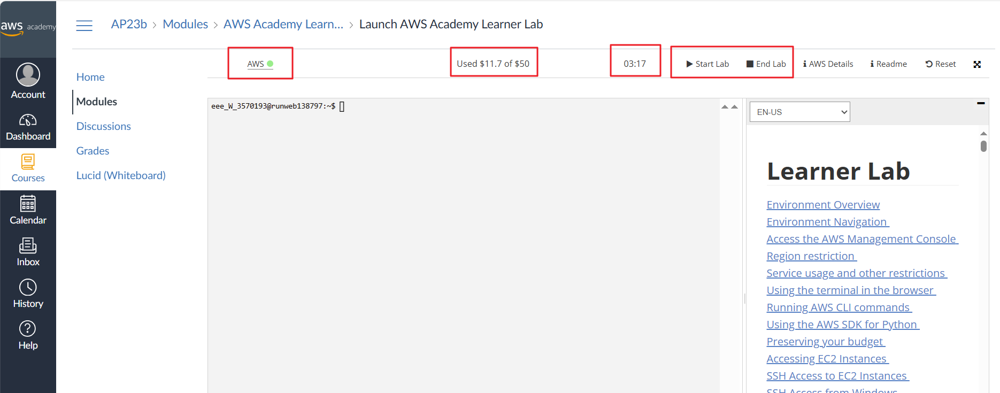
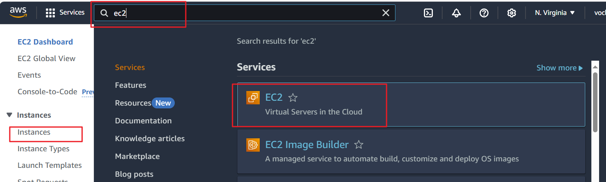

[TOC]

# KN02: Cloud-Onboarding & SSH

Beachten Sie die [allgemeinen Informationen zu den Abgaben](../Abgaben.md).

**Richtzeit:** ca. 4 Lektionen

In dieser Kompetenz richten Sie Ihre Cloud-Arbeitsumgebung ein (AWS Academy Learner Lab), verstehen die SSH-Schlüssel-Authentifizierung im Detail und erstellen Ihre erste Cloud-Instanz – natürlich mit der cloud-init-Konfiguration aus KN01. Alles, was wir hier mit AWS umsetzen, bieten auch andere Public-Cloud-Anbieter (Microsoft Azure, Google Cloud).

**Theorie zu dieser Kompetenz:** [SSH mit Public/Private Keys](../Theorie/SSH.md) · [Cloud-init](../Theorie/CloudInit.md) · [Servicemodelle](../Theorie/Servicemodelle.md)

## Lernziele

Die Lernziele sind als Selbstcheck formuliert. Prüfen Sie sie **vor der Abgabe**: Jede Aussage, die Sie nicht bestätigen können, ist eine Lücke – und genau dort wird die Lehrperson bei der Abnahme nachfragen.

- [ ] Ich komme mit dem AWS Academy Learner Lab zurecht: Umgebung starten/stoppen, Budget einsehen, und ich weiss, was nach 4 Stunden passiert.
- [ ] Ich kann eine EC2-Instanz erstellen und die Einstellungen zu Speicher, RAM und CPU bestimmen.
- [ ] Ich kann erklären, wie die Public/Private-Key-Authentifizierung funktioniert und wo (Gerät und Verzeichnis) welcher Schlüssel liegen muss.
- [ ] Ich kann den öffentlichen Schlüssel aus dem privaten extrahieren und den `ssh`-Befehl mit seinen Parametern anwenden.
- [ ] Ich kann SSH-Schlüssel per cloud-init verteilen und habe mein persönliches cloud-init-Template erstellt (inkl. Schlüssel der Lehrperson).
- [ ] Ich kann begründen, warum dieselbe cloud-init-Datei lokal (Multipass) und in AWS funktioniert – und was das über Infrastructure as Code aussagt.


## A) Learner Lab einrichten (20%)

Sie haben per E-Mail eine Einladung zu einem AWS-Kurs bekommen (Titel «Course Invitation»). Erstellen Sie den notwendigen Account. **Achtung:** Falls Sie aufgefordert werden, eine Kreditkarte anzugeben, sind Sie am falschen Ort!

Verwenden Sie ab sofort für alle Kompetenznachweise den Kurs «**AWS Academy Learner Lab**».



Nachdem Sie den Link aufgerufen haben, sehen Sie das folgende Bild. Die markierten Bereiche von links nach rechts:

- Der Status Ihrer Umgebung. Wenn der Kreis **grün** ist, ist die Umgebung gestartet und Sie können auf den AWS-Link klicken, um in die AWS-Konsole zu gelangen.
- Der bereits verbrauchte Anteil Ihres **Budgets**.
- Die **verbleibende Zeit**, bevor die Umgebung heruntergefahren wird. Fortschritte werden **nicht** gelöscht, aber die Umgebung stoppt nach 4 Stunden und muss neu gestartet werden.
- Links zum Starten und Stoppen.
- Die graue Konsole unten benötigen Sie **nicht**.



Gehen Sie nun in den AWS-Bereich **EC2** (Link «AWS» mit dem grünen Kreis). Falls der Punkt noch **rot** ist, warten Sie einige Minuten. In EC2 werden Sie Ihre virtuellen Server (Instanzen) erstellen.



**Abgaben:**

- Screenshot des gestarteten Learner Labs (grüner Kreis, Budget sichtbar).
- Screenshot ihrer EC2 Umgebung sichtbar, inkl. Ihrem Benutzernamen rechts oben.


## B) SSH-Schlüssel verstehen: das Zwei-Schlüssel-Experiment (45%)

[Lesen Sie zuerst das Theorie-Kapitel zum Umgang mit SSH und Private/Public Keys](../Theorie/SSH.md).

### B1) Instanz mit Schlüsselpaar erstellen

Erstellen Sie in EC2 eine Instanz mit folgenden Parametern (alle anderen Einstellungen belassen – aber schauen Sie sie durch, Sie werden sie in späteren KNs brauchen):

- Name: z. B. *KN02*
- OS-Image: **Ubuntu 26.04**
- Instanz-Typ: **t3.micro**
- Key Pair: Erstellen Sie **zwei** neue Schlüssel mit den Standardeinstellungen und benennen Sie sie *vorname1* und *vorname2*. Wählen Sie für die Instanz den **ersten** Schlüssel aus.

> AWS speichert Ihre privaten Schlüssel **nicht** – sie können nicht wiederhergestellt werden. Auf dem Server liegt immer nur der öffentliche Schlüssel. Verlieren Sie die Dateien nicht, Sie brauchen beide Schlüssel auch in Teil C.

Verschieben Sie die beiden heruntergeladenen .pem-Dateien aus dem Download-Ordner an den Ort, wo SSH-Schlüssel hingehören – in den Ordner `.ssh` in Ihrem Home-Verzeichnis (falls er noch nicht existiert, erstellen Sie ihn):

| OS | Speicherort |
|---|---|
| Windows | `C:\Users\<IhrBenutzer>\.ssh\` |
| macOS | `/Users/<IhrBenutzer>/.ssh/` (kurz: `~/.ssh/`) |
| Linux | `/home/<IhrBenutzer>/.ssh/` (kurz: `~/.ssh/`) |

Unter macOS/Linux zusätzlich die Dateirechte einschränken, sonst verweigert SSH den Schlüssel: `chmod 400 ~/.ssh/vorname1.pem` (für beide Dateien).

### B2) Das Experiment

Zeigen Sie, dass Sie sich **nur** mit dem **ausgewählten** Schlüssel einloggen können:

- SSH-Login mit dem **ersten** Schlüssel → funktioniert.
- SSH-Login mit dem **zweiten** Schlüssel → wird abgelehnt.

Extrahieren Sie anschliessend aus beiden **privaten** Schlüsseln den jeweiligen **öffentlichen** Schlüssel:

```bash
ssh-keygen -y -f vorname1.pem > vorname1.pub
```

Vergleichen Sie den extrahierten öffentlichen Schlüssel von *vorname1* mit dem Inhalt von `~/.ssh/authorized_keys` **auf dem Server**. Was stellen Sie fest? Sie brauchen die extrahierten öffentlichen Schlüssel gleich in Teil C – legen Sie sie bereit.

**Abgaben:**

- Screenshot der Instanz-Details (wenn die Instanz läuft) (öffentliche IP und verwendetes Key Pair sichtbar).
- Als kurzer Text: Diskgrösse, Betriebssystem, RAM und Anzahl CPUs Ihrer Instanz.
- Screenshot des ssh-Befehls und Resultats mit dem **ersten** Schlüssel (Erfolg).
- Screenshot des ssh-Befehls und Resultats mit dem **zweiten** Schlüssel (Ablehnung).
- Screenshot des Vergleichs: extrahierter Public Key ↔ `authorized_keys` auf dem Server, mit 1–2 Sätzen Erklärung, **warum** genau dieser Schlüssel dort liegt.


## C) Erste Instanz mit cloud-init & Ihr Template (35%)

Jetzt schliesst sich der Kreis zu KN01: Sie verwenden Ihre cloud-init-Konfiguration aus KN01 in AWS – **dieselbe Datei, andere Cloud.**

### C1) cloud-init mit SSH-Schlüssel erweitern & Instanz erstellen

Erweitern Sie Ihre `cloud-init-kn01.yaml` aus KN01: Fügen Sie im `users`-Block Ihrem Benutzer den **öffentlichen** Schlüssel von *vorname1* hinzu (`ssh_authorized_keys`, Format beachten: eine Zeile, keine Umbrüche).

Erstellen Sie eine neue Instanz (Ubuntu 26.04, t3.micro):

- Als Key Pair wählen Sie im GUI den **zweiten** Schlüssel (*vorname2*).
- Ihre cloud-init-Konfiguration kopieren Sie beim Erstellen in das Feld **User data** (Sektion *Advanced details*).

Sie verwenden jetzt also beide Schlüssel gleichzeitig – einen via GUI (für den Standardbenutzer), einen via cloud-init (für Ihren eigenen Benutzer). Weisen Sie nach, dass sich die beiden Mechanismen nicht gegenseitig beeinflussen:

- Login als **Standardbenutzer** (`ubuntu`) mit dem **zweiten** Schlüssel (im GUI ausgewählt) → funktioniert.
- Login als **Ihr cloud-init-Benutzer** mit dem **ersten** Schlüssel → funktioniert.
- Login als **Ihr cloud-init-Benutzer** mit dem **zweiten** Schlüssel → funktioniert **nicht**.

**Abgaben (C1):**

- Die `cloud-init-kn01.yaml` (AWS-Version) als **Datei** im Repo mit dem hinzugefügten public Key.
- Screenshot der Instanz-Details nachdem die Instanz läuft, so dass das Feld **Key pair assigned at launch** (*vorname2*) sichtbar ist und auch die öffentliche IP (oder DNS Name).
- Screenshot: SSH-Login als Standardbenutzer (`ubuntu`) mit dem **zweiten** Schlüssel (Erfolg).
- Screenshot: SSH-Login als Ihr cloud-init-Benutzer mit dem **ersten** Schlüssel (Erfolg).
- Screenshot: SSH-Login als Ihr cloud-init-Benutzer mit dem **zweiten** Schlüssel (Ablehnung).

### C2) Nachweise in der laufenden Instanz

Bleiben Sie mit dem **ersten** Schlüssel eingeloggt (der einzige, mit dem sich Ihr zusätzlicher cloud-init-Benutzer anmelden lässt) und weisen Sie von dort aus nach:

- Ihre Erweiterungen aus KN01 (Paket, Datei) sind auch in dieser AWS-Instanz vorhanden. Zeigen Sie nur **eine** Erweiterung als Screenshot
- Rufen Sie das cloud-init-Log auf (`/var/log/cloud-init-output.log`) – derselbe Pfad wie lokal in KN01.

**Abgaben (C2):**

- Screenshot: Nachweis **einer** KN01-Erweiterung in der AWS-Instanz (z. B. Ihre Datei oder Ihr Paket).
- Screenshot: Auszug aus dem cloud-init-Log (Befehl sichtbar, oberer Teil des Logs reicht).

### C3) Ihr persönliches Template

Erstellen Sie aus C1 die Datei `cloud-init-template.yaml` – **Ihr Standard-Template für alle folgenden KNs**:

- Ihr Benutzer mit Ihrem öffentlichen Schlüssel (*vorname1*).
- Zusätzlich der [öffentliche Schlüssel Ihrer Lehrperson](../PublicKey/) (nur der Ihrer Lehrperson!), damit diese Zugriff auf Ihre zukünftigen Instanzen hat. Das Template enthält also **zwei** öffentliche Schlüssel.
- Härtung: `ssh_pwauth: false` und `disable_root: true`.
- `package_update: true`.

**Abgaben (C3):**

- Ihr `cloud-init-template.yaml` als **Datei** im Repo. Dokumentieren Sie die drei zusätzlichen Konfigurationen im Template
- Reflexion (3–5 Sätze): Sie haben dieselbe cloud-init-Datei lokal (Multipass) und in AWS verwendet. Was bedeutet das für die Portabilität Ihrer Konfiguration – und warum ist das bei GUI-Klicks prinzipiell unmöglich?


## Häufige Fehlerquellen

- **Lab nicht gestartet:** Der AWS-Link funktioniert nur bei grünem Kreis. Nach 4 Stunden müssen Sie neu starten – Instanzen sind dann gestoppt, nicht gelöscht.
- **Öffentliche IP hat geändert:** Nach jedem Stop/Start bekommt die Instanz eine neue öffentliche IP – alten ssh-Befehl anpassen.
- **`Permission denied (publickey)`:** Falscher Schlüssel, falscher Benutzername (bei Ubuntu-Images: `ubuntu` bzw. Ihr cloud-init-Benutzer) oder falsches Schlüsselformat. Evtl. haben sie eine AWS Instanz gestartet, dann ist der Benutzername `ec2-user`
- **`WARNING: UNPROTECTED PRIVATE KEY FILE` (macOS/Linux):** Rechte der .pem-Datei einschränken: `chmod 400 vorname1.pem`.
- **SSH-Schlüssel im cloud-init wird ignoriert:** Format prüfen – der Schlüssel muss auf **einer** Zeile stehen: `ssh-ed25519 <schlüssel> kommentar` bzw. `ssh-rsa <schlüssel> kommentar`.
- **cloud-init lief nicht / Ihre Konfiguration hat gar keine Wirkung:** Prüfen Sie zuerst, ob die erste Zeile `#cloud-config` fehlt – ohne sie wird die ganze Datei stillschweigend ignoriert. **Anders als in KN01 mit Multipass macht das hier einen echten Unterschied:** AWS übernimmt Ihr *User data*-Feld unverändert, es gibt (im Gegensatz zu Multipass) keine Instanz, die die Datei vorher einliest und die Kennzeichnung selbst wieder ergänzt. Ausserdem: YAML validieren (<https://www.yamllint.com/>) und Log lesen: `/var/log/cloud-init-output.log`.
- **Falsche Region:** Das Learner Lab arbeitet in `us-east-1` – wenn Sie Ihre Instanzen «nicht finden», prüfen Sie die Region oben rechts in der AWS-Konsole.
