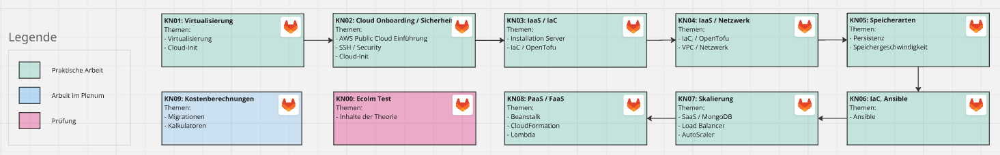

---
| Feld | Wert |
|---|---|
| Modulnummer | m346 |
| Modulname | Cloudlösungen konzipieren und realisieren |
| Modulverantwortlich | Yves Nussle |
| E-Mail | yves.nussle@tbz.ch |
| Modulbaukasten | https://www.modulbaukasten.ch/module/346 |

# m346: Cloudlösungen konzipieren und realisieren

## Übersicht

In diesem Modul erarbeiten Sie sich teils geführt, teils selbstständig Kompetenzen. 

## Unterlagen

- [Informationen zu den Abgaben](./Abgaben.md) – inkl. Regeln zum Einsatz von KI
- [Theorie](./Theorie/README.md) – alle Theorie-Kapitel zum Selbststudium (inkl. SSH, YAML, cloud-init, OpenTofu, Ansible)
- [Kompetenznachweise](./Kompetenznachweise/) – die Aufträge KN01–KN09
- [Tools](./Tools/) – Installations- und Setup-Anleitungen (Multipass, OpenTofu, Ansible, AWS-Credentials)
- [Kompetenzmatrix](./Kompetenzmatrix.md)

## Leistungsmessung

Die Kompetenzen werden gewichtet gewertet und jede Kompetenz trägt zur Gesamtnote bei (Gewichtung siehe Vorgabe der Lehrperson).
