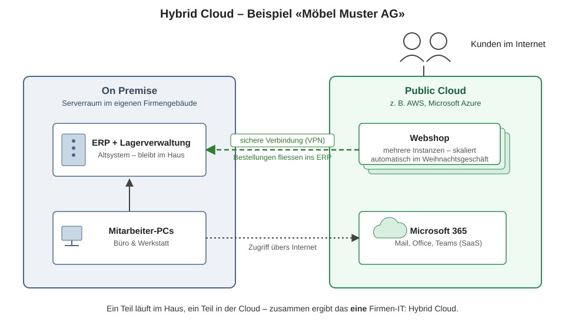

# Betriebsmodelle

## Lernziele

- Sie kennen die drei Betriebsmodelle On Premise, Hybrid Cloud und Cloud-Native und können sie erklären.
- Sie können die zusätzliche Unterteilung in Public und Private Cloud erklären.
- Sie können für ein gegebenes Firmenszenario das passende Betriebsmodell begründen.

## Die drei Betriebsmodelle

**On Premise.** Alle Hard- und Software wird von der Firma selbst betrieben, in eigenen oder gemieteten Rechenzentren. Volle Kontrolle und Datenhoheit – aber auch volle Verantwortung für Hardware, Strom, Kühlung, Redundanz und Personal.

**Hybrid Cloud.** Ein Teil läuft On Premise, ein Teil in der Cloud. Das ist heute das **am weitesten verbreitete** Modell – oft nicht als bewusste Strategie, sondern als Realität: Sobald eine Firma Microsoft-365-Lizenzen nutzt, ist ein Teil der Infrastruktur in der Cloud, auch wenn die Kernsysteme noch auf eigenen Servern laufen.

**Cloud-Native.** Die komplette Infrastruktur und alle Applikationen laufen in der Cloud. Typisch für junge Firmen, die nie eigene Server hatten («born in the cloud»).

## Public vs. Private Cloud

Quer zu den Betriebsmodellen liegt eine zweite Unterscheidung:

| | Public Cloud | Private Cloud |
|---|---|---|
| Infrastruktur | geteilt bei einem öffentlichen Anbieter (AWS, Azure, Google) | exklusiv für eine Organisation |
| Betreiber | der Anbieter | die Firma selbst oder ein Dienstleister |
| Typisch für | die meisten Workloads | Banken, Behörden, besondere Compliance-Anforderungen |

Auch hier sind Mischformen üblich: Eine Bank kann eine Private Cloud für Kundendaten betreiben und die Public Cloud für die Webseite nutzen.

## Beispiel einer hybriden Architektur

Die «Möbel Muster AG» produziert und verkauft Möbel. Ihre IT sieht so aus:

- Das **ERP mit Lagerverwaltung** ist ein Altsystem und läuft auf einem Server **im Firmengebäude** – es wurde vor 15 Jahren angeschafft und lässt sich nicht einfach in die Cloud verschieben.
- Der **Webshop** läuft in der **Public Cloud** – dort kann er im Weihnachtsgeschäft automatisch auf mehrere Instanzen skalieren, statt dass die Firma für drei Wochen Spitzenlast das ganze Jahr Hardware bereithält.
- Für **Mail und Office** nutzen alle Microsoft 365 – also SaaS aus der Cloud.
- Bestellungen aus dem Webshop fliessen über eine gesicherte Verbindung (VPN) ins lokale ERP.

Ein Teil im Haus, ein Teil in der Cloud, sauber verbunden – das ist Hybrid Cloud. Und das Beispiel zeigt auch das typische Muster: **Neues und Skalierendes** wandert in die Cloud, **Altes und Schwer-Migrierbares** bleibt (vorerst) im Haus. 

## Entscheidungskriterien in der Praxis

Warum wählt eine Firma welches Modell? Die häufigsten Treiber:

| Kriterium | spricht für On Premise / Private | spricht für Public Cloud |
|---|---|---|
| Datenschutz / Regulierung | Daten dürfen das Land/Haus nicht verlassen | Anbieter bietet Schweizer/EU-Regionen mit Zertifizierungen |
| Kostenstruktur | konstante, planbare Last (Investition lohnt sich) | schwankende Last, schnelles Wachstum (pay as you go) |
| Know-how | eigenes Infrastruktur-Team vorhanden | kleines Team, Fokus aufs Produkt |
| Altsysteme | Legacy-Software, die sich nicht migrieren lässt | Neuentwicklungen |

## Selbsttest

1. Eine Treuhand-Firma nutzt eine lokale Buchhaltungssoftware auf einem Server im Keller und Microsoft 365 für Mail und Office. Welches Betriebsmodell liegt vor?

Hybrid Cloud: Buchhaltung On Premise, Mail/Office in der (Public) Cloud.

2. Was ist der Unterschied zwischen «Cloud-Native» und «Public Cloud»? Die Begriffe werden oft verwechselt.

Cloud-Native ist ein Betriebsmodell (alles läuft in der Cloud, nichts On Premise). Public/Private beschreibt, wem die Cloud-Infrastruktur gehört. Eine Firma kann Cloud-Native in einer Private Cloud sein – oder hybrid mit Public-Cloud-Anteilen.

3. Warum ist Hybrid Cloud in der Praxis oft kein Zielzustand, sondern ein Übergangszustand – und warum dauert dieser Übergang trotzdem oft Jahre?

Viele Firmen wollen langfristig in die Cloud, aber Legacy-Systeme, Abhängigkeiten (wie das AD-Beispiel), Verträge und Migrationskosten verhindern den Wechsel auf einen Schlag. Jede Abhängigkeit muss einzeln abgelöst werden.

## Quellen

- redhat.com: [Public Cloud vs. Private Cloud](https://www.redhat.com/en/topics/cloud-computing/public-cloud-vs-private-cloud-and-hybrid-cloud)
