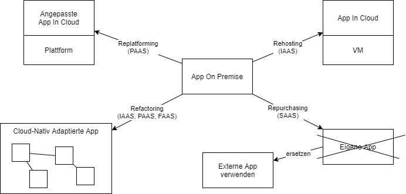

# Cloud-Migrationsmodelle

## Lernziele

- Sie kennen die Migrationsmodelle Rehosting, Replatforming, Refactoring und Repurchasing und deren Ziel-Servicemodelle.
- Sie können für ein Firmenszenario ein Migrationsmodell begründen und Aufwand/Nutzen abwägen.

## Ausgangslage

Eine Firma betreibt eine Applikation On Premise und will (oder muss) in die Cloud – etwa weil die Hardware am Lebensende ist, das Rechenzentrum schliesst oder Skalierung nötig wird. Die zentrale Frage: **Wie viel wird an der Applikation geändert?** Die Antwort bestimmt Kosten, Dauer, Risiko und den langfristigen Nutzen.

## Die vier Modelle

**Rehosting (Lift & Shift) → IaaS.** Die Applikation wird mit minimalen Anpassungen auf virtuelle Server in der Cloud gezügelt. Wie ein Umzug, bei dem die Möbel unverändert in die neue Wohnung kommen.
Aufwand: klein. Risiko: klein. Nutzen: begrenzt – die Applikation profitiert kaum von Cloud-Eigenschaften (Skalierung, Managed Services); man tauscht im Wesentlichen den Standort der Server. Oft der erste Schritt unter Zeitdruck.

**Replatforming (Lift & Reshape) → PaaS.** Die Applikation wird punktuell angepasst, damit sie von verwalteten Plattform-Diensten profitiert – typisch: die selbstbetriebene Datenbank wird durch RDS ersetzt, die Applikation läuft auf Elastic Beanstalk statt auf selbst gepflegten VMs.
Aufwand: mittel. Nutzen: deutlich weniger Betriebsaufwand, ohne die Applikation neu zu schreiben.

**Refactoring / Rearchitecting → Microservices, Container, FaaS.** Die Applikation wird umgebaut oder neu geschrieben, um Cloud-Eigenschaften voll zu nutzen: Microservices mit Kubernetes, Serverless-Funktionen, automatische Skalierung. Mischformen sind üblich.
Aufwand: gross (Monate bis Jahre). Nutzen: maximal – aber nur gerechtfertigt, wenn die Applikation strategisch wichtig ist und weiterentwickelt wird.

**Repurchasing → SaaS.** Die eigene Applikation wird durch ein fertiges SaaS-Produkt ersetzt (z. B. Eigenbau-CRM → Salesforce oder Zoho). Es wird nicht migriert, sondern abgelöst; die eigentliche Arbeit ist die **Datenmigration** und die Anpassung der Prozesse an das neue Produkt.
Aufwand: mittel (v. a. organisatorisch). Nutzen: kein Betrieb mehr – aber auch Abhängigkeit vom Hersteller und Verlust von Spezialfunktionen.

Der Vollständigkeit halber: In der Literatur (AWS «6 R») kommen noch **Retire** (Applikation abschalten) und **Retain** (bewusst On Premise behalten) dazu.

## Entscheidungshilfe

| Frage | Wenn ja → |
|---|---|
| Muss es schnell gehen, wenig Budget, wenig Risiko? | Rehosting |
| Soll der Betriebsaufwand sinken, ohne Neuentwicklung? | Replatforming |
| Ist die Applikation strategisch und wird laufend weiterentwickelt? | Refactoring |
| Gibt es ein etabliertes Standardprodukt, das den Zweck erfüllt? | Repurchasing |
| Braucht es die Applikation überhaupt noch? | Retire |

**Praxisbezug KN09:** Sie rechnen genau diese Varianten für ein CRM-Szenario durch – Rehosting (AWS/Azure-Kostenrechner), Replatforming (Heroku) und Repurchasing (Zoho/Salesforce) – und beraten den «CEO» (Ihre Lehrperson).

## Selbsttest

1. Eine Firma «migriert» ihr Eigenbau-CRM zu Salesforce. Warum ist «Migration» hier eigentlich das falsche Wort, und wo liegt der Hauptaufwand?

Die Applikation wird nicht bewegt, sondern ersetzt (Repurchasing). Der Hauptaufwand liegt in der Datenübernahme, der Anpassung der Geschäftsprozesse an das Produkt und der Schulung – nicht in der Technik der alten Applikation.

2. Warum bringt Rehosting oft kaum Kostenersparnis – obwohl «Cloud» als günstig gilt?

Die Applikation läuft 24/7 auf gemieteten VMs, genau wie vorher auf eigener Hardware – nur beim Anbieter. Cloud wird günstig durch Elastizität (nur zahlen, was gebraucht wird) und Managed Services – beides nutzt Lift & Shift nicht.

3. Ordnen Sie zu: «Wir ersetzen unsere selbst gehostete MariaDB durch AWS RDS, der Applikationscode bekommt nur einen neuen Connection String.»

Replatforming – die Architektur bleibt, aber eine Komponente wird durch einen Plattform-Dienst (PaaS) ersetzt.

## Quellen

- AWS: [6 Strategies for Migrating Applications to the Cloud](https://aws.amazon.com/blogs/enterprise-strategy/6-strategies-for-migrating-applications-to-the-cloud/)
