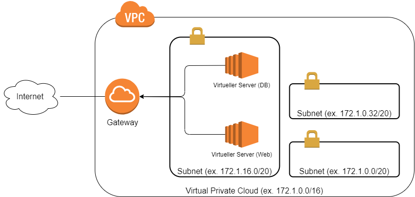
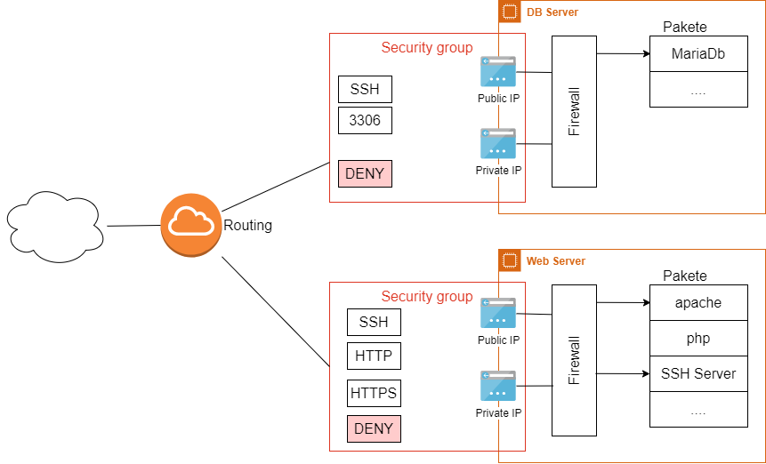
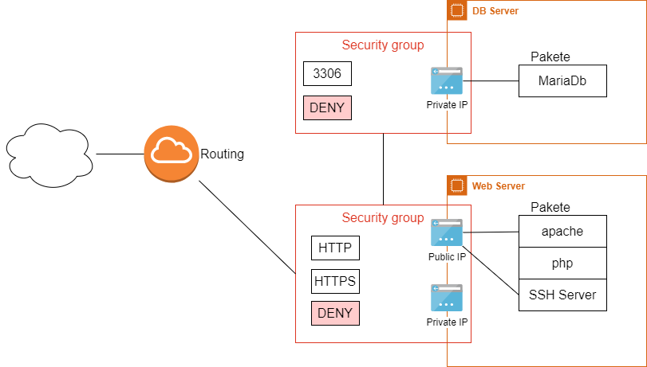

# Netzwerk und Sicherheit

> Dieses Kapitel ist der wichtigste Einzel-Input des Moduls. Vieles ist Wiederholung aus früheren Modulen (m117) – aber ohne Netzwerkverständnis lässt sich keine sichere Cloud-Umgebung bauen.

## Lernziele

- Sie können die Begriffe VPC, Subnetz, CIDR, Netzwerk-Interface, Gateway erklären.
- Sie kennen den Unterschied zwischen privaten, öffentlichen und statischen IPs.
- Sie können erklären, was ein Port ist, und kennen die im Modul wichtigen Ports (22, 80, 443, 3306).
- Sie können Security Groups so gestalten, dass nur das Nötige erreichbar ist – und wissen, welche weiteren Schutzschichten eine Anfrage durchläuft.
- Sie kennen die Sicherheitsverantwortung von Benutzer und Anbieter (Shared Responsibility).

## Das Netzwerk in der Public Cloud

**VPC (Virtual Private Cloud):** Ihr eigenes, isoliertes Netzwerk innerhalb des Cloud-Anbieters. Im Bild das Netz `172.1.0.0/16`. Andere Kunden von AWS sehen Ihr VPC nicht – die Isolation übernimmt der Anbieter (Mandantenfähigkeit).

**Subnetz:** Ein Teilnetz innerhalb des VPC (also ein Subnetz eines Subnetzes). Jede Instanz wird in genau einem Subnetz platziert – automatisch oder von Ihnen gezielt. Subnetze dienen der Strukturierung (z. B. öffentliches Subnetz für Webserver, privates für Datenbanken).

**CIDR-Notation kurz aufgefrischt:** `172.1.0.0/16` bedeutet: Die ersten 16 Bit sind fix (172.1), der Rest ist frei → Adressen von 172.1.0.0 bis 172.1.255.255. Ein `/24` (z. B. `172.1.5.0/24`) lässt nur das letzte Oktett frei → 256 Adressen. Je grösser die Zahl nach dem `/`, desto kleiner das Netz.

**Gateway:** Steht stellvertretend für das Routing zwischen dem Internet und Ihren Subnetzen. Ohne Internet-Gateway kommt keine Anfrage von aussen hinein – und keine hinaus.

## IP-Adressen: privat, öffentlich, statisch

| Typ | Sichtbar | Beispiel | Eigenschaft |
|---|---|---|---|
| Private IP | nur innerhalb des VPC | 172.1.5.10 | für die Kommunikation zwischen Ihren Instanzen (z. B. Web → DB) |
| Öffentliche IP | aus dem Internet | 54.93.x.x | wird der Instanz beim Start zugeteilt – und ändert bei Stop/Start! |
| Statische (Elastic) IP | aus dem Internet | 54.93.x.x | explizit reserviert, bleibt bei Stop/Start erhalten |

Die wichtigste Stolperfalle im Learner Lab: Die **öffentliche IP ändert sich bei jedem Stop/Start** der Instanz. Wer die IP eines Webservers irgendwo fix einträgt (DNS, Konfigurationsdatei, Bookmark), braucht eine Elastic IP. Private IPs bleiben dagegen erhalten.

## Ports

Eine IP identifiziert die Maschine, ein **Port** den Dienst darauf. Ein Server kann gleichzeitig SSH (22), eine Webseite (80) und eine Datenbank (3306) anbieten – die Portnummer entscheidet, welcher Dienst die Anfrage bekommt.

| Port | Dienst | Im Modul |
|---|---|---|
| 22 | SSH | Fernzugriff auf jede Instanz |
| 80 | HTTP | Webserver (unverschlüsselt) |
| 443 | HTTPS | Webserver (verschlüsselt) |
| 3306 | MySQL/MariaDB | Datenbankzugriff |

## Die Stationen einer Anfrage

Eine Anfrage aus dem Internet durchläuft mehrere Schichten, die **alle** zur Sicherheit beitragen:

**Security Group:** Eine Firewall auf Instanz-Ebene, die Anfragen auf spezifischen Ports blockiert oder durchlässt. Regeln können zusätzlich die **Quelle** einschränken – z. B. Port 3306 nur aus dem eigenen Subnetz statt aus dem ganzen Internet. Das ist Ihr wichtigstes Sicherheitswerkzeug im Modul.

**Netzwerk-Adapter:** Eine Instanz hat grundsätzlich zwei virtuelle Adapter – einen fürs private Subnetz, einen für die öffentliche IP.

**Server-Firewall:** Das OS bringt eine eigene Firewall mit (ufw/iptables). Bei Public-Cloud-Images ist sie standardmässig **deaktiviert** – die Security Group übernimmt diese Rolle.

**Pakete/Dienste selbst:** Software bringt oft eigenen Schutz mit. MariaDB akzeptiert per Standard nur Verbindungen von localhost (127.0.0.1, `bind-address`). Sie könnten alle Firewalls öffnen und kämen trotzdem nicht von aussen auf die Datenbank – erst die Änderung der Konfiguration (`0.0.0.0`) erlaubt Fernzugriff. Merken Sie sich diese Schicht: Sie erklärt viele «Firewall ist offen, geht aber trotzdem nicht»-Situationen.

So sieht die praktische Zielarchitektur im Modul aus – die Datenbank ist von aussen gar nicht erreichbar:

**Goldene Regel für alle KNs: Die Datenbank ist niemals öffentlich erreichbar.** Port 3306 wird nur für das interne Subnetz geöffnet, nie für 0.0.0.0/0. Eine KI, die Ihnen eine Security Group mit «3306 von überall» generiert, hat einen Fehler gemacht, den Sie erkennen müssen.

## Wer ist für welche Sicherheit verantwortlich? (Shared Responsibility)

**Der Anbieter** sorgt für die Sicherheit **der** Cloud: physische Sicherheit der Rechenzentren (Zutrittskontrolle, Redundanz von Strom und Netzwerk, Synchronisation über Standorte), Mandantentrennung, Schutz der Infrastruktur (Intrusion Detection/Prevention, Penetration Tests), Compliance mit regionalen Datenschutzregeln.

**Sie** sorgen für die Sicherheit **in** der Cloud:

1. **Netzwerk**: Subnetz-Trennung, Security Groups, keine unnötig offenen Ports.
2. **Zugriffskontrolle (IAM)**: Wer darf welche Cloud-Ressourcen verwalten? Berechtigungen werden als Policies definiert (JSON), z. B. «darf Instanzen starten/stoppen, aber nicht erstellen». Im Learner Lab ist IAM eingeschränkt – Sie nutzen die vorgegebene LabRole.
3. **Härtung der Instanz**: kein Root-Login, Schlüssel statt Passwörter, minimale Paketinstallation (vertieft in m182).
4. **Applikationssicherheit**: sichere Software-Entwicklung, OWASP Top 10 (vertieft in m183).

Der Anbieter kann perfekte Rechenzentren betreiben – wenn Sie Port 3306 für die Welt öffnen oder Ihren SSH-Key in ein öffentliches Repo pushen, hilft das nichts.

## Selbsttest

1. Ihre Webserver-Instanz erreicht die Datenbank-Instanz nicht auf Port 3306. Nennen Sie die vier Schichten, die Sie der Reihe nach prüfen würden.

(1) Security Group der DB-Instanz: Ist 3306 aus dem Quell-Subnetz/der Quell-SG erlaubt? (2) Richtige IP: Wird die private IP der DB verwendet? (3) Läuft der Dienst überhaupt (`systemctl status mariadb`)? (4) Paket-Konfiguration: Steht `bind-address` noch auf 127.0.0.1? Werkzeuge: `telnet <ip> 3306`, Logs.

2. Wie viele Adressen umfasst das Subnetz 172.1.5.0/24, und liegt 172.1.6.20 darin?

256 Adressen (172.1.5.0–172.1.5.255, davon einige reserviert). 172.1.6.20 liegt **nicht** darin – das dritte Oktett gehört bei /24 zum fixen Teil.

3. Warum ändert die öffentliche IP einer normalen EC2-Instanz nach Stop/Start – und die private nicht?

Öffentliche IPs werden aus einem gemeinsamen Pool des Anbieters dynamisch zugeteilt und beim Stoppen zurückgegeben (sie sind knapp und kosten). Die private IP gehört zum Subnetz der Instanz und bleibt ihr zugewiesen. Wer eine konstante öffentliche IP braucht, reserviert eine Elastic IP.

4. Eine KI generiert Ihnen eine Security Group: Port 22 von 0.0.0.0/0, Port 3306 von 0.0.0.0/0. Was beanstanden Sie?

Port 3306 von überall ist ein schwerer Fehler – die Datenbank wäre aus dem ganzen Internet erreichbar (Brute-Force, Scans). Richtig: 3306 nur aus dem internen Subnetz oder von der Security Group des Webservers. Port 22 von überall ist im Schulkontext vertretbar, in Produktion würde man auch das einschränken.

5. AWS wirbt mit hochsicheren Rechenzentren. Ein Kunde speichert trotzdem Kundendaten in einem öffentlich lesbaren S3-Bucket. Wer ist verantwortlich?

Der Kunde – Shared Responsibility: AWS sichert die Infrastruktur («Sicherheit der Cloud»), die korrekte Konfiguration der eigenen Ressourcen («Sicherheit in der Cloud») liegt beim Kunden.

## Quellen

- AWS: [VPC-Dokumentation](https://docs.aws.amazon.com/vpc/latest/userguide/what-is-amazon-vpc.html)
- AWS: [Shared Responsibility Model](https://aws.amazon.com/compliance/shared-responsibility-model/)
