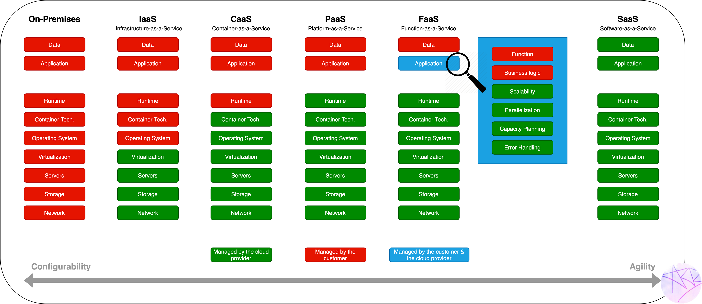

# Servicemodelle

## Lernziele

- Sie kennen die vier Servicemodelle IaaS, PaaS, SaaS und FaaS und können sie erklären.
- Sie wissen, welches Modell auf welchem aufbaut, und können die Verantwortungsteilung (Sie vs. Anbieter) pro Modell benennen.
- Sie können reale Produkte den Modellen zuordnen – inklusive der Dienste, die Sie im Modul selbst benutzen.

## Die Grundidee: Wer verwaltet was?

Bei den Servicemodellen geht es um eine einzige Frage: **Wie viel der Betriebsverantwortung geben Sie an den Cloud-Anbieter ab?** Je mehr Sie abgeben, desto weniger Kontrolle haben Sie – und desto weniger Aufwand.

| Schicht | On Premise | IaaS | PaaS | FaaS | SaaS |
|---|---|---|---|---|---|
| Applikation | Sie | Sie | Sie | Sie (nur Code) | Anbieter |
| Laufzeit / Middleware | Sie | Sie | Anbieter | Anbieter | Anbieter |
| Betriebssystem | Sie | Sie | Anbieter | Anbieter | Anbieter |
| Virtualisierung | Sie | Anbieter | Anbieter | Anbieter | Anbieter |
| Hardware / Netzwerk | Sie | Anbieter | Anbieter | Anbieter | Anbieter |

## Die vier Modelle

**IaaS – Infrastructure as a Service.** Sie mieten Rechenleistung, Speicher und Netzwerk und installieren darauf alles selbst. Maximale Kontrolle, maximaler Betriebsaufwand: OS-Updates, Härtung, Skalierung – alles Ihre Aufgabe. Beispiele: AWS EC2, Azure Virtual Machines, Google Compute Engine.

**PaaS – Platform as a Service.** Sie liefern Ihre Applikation, der Anbieter stellt die komplette Plattform darunter (OS, Laufzeit, oft auch Load Balancer und Datenbank). Sie konzentrieren sich auf die Software. Beispiele: AWS Elastic Beanstalk, Heroku, Google App Engine, AWS RDS (Datenbank als Plattform-Dienst).

**FaaS – Function as a Service / Serverless.** Sie liefern nur noch einzelne Funktionen (Code-Schnipsel), die bei Bedarf ausgeführt werden. Es läuft kein Server «für Sie» – die Infrastruktur existiert nur während der Ausführung. Der grosse Vorteil: **Kosten fallen nur bei Ausführung an.** Eine Funktion, die einmal pro Nacht ein Backup erstellt, kostet praktisch nichts – eine dafür rund um die Uhr laufende EC2-Instanz schon. Beispiele: AWS Lambda, Azure Functions, Cloudflare Workers.

**SaaS – Software as a Service.** Sie benutzen fertige Software im Browser, ohne irgendetwas zu betreiben. Jede Webseite mit Login ist im Prinzip SaaS. Beispiele: Microsoft 365, Google Workspace, Salesforce, MongoDB Atlas (Datenbank als fertiger Dienst).

## Merkhilfe: das Pizza-Modell

- **On Premise**: Sie backen die Pizza selbst, inklusive Teig, Ofen und Küche.
- **IaaS**: Sie mieten eine fertige Küche mit Ofen – Teig und Belag bringen Sie mit.
- **PaaS**: Der Lieferdienst backt nach Ihrem Rezept – Sie definieren nur die Pizza.
- **FaaS**: Sie bestellen einzelne Stücke, genau dann, wenn Sie Hunger haben.
- **SaaS**: Sie gehen ins Restaurant und essen, was auf der Karte steht.

## Anwendung im Modul

Sie benutzen im Verlauf des Moduls **alle vier Modelle selbst** – prüfen Sie am Ende, ob Sie jede Zuordnung begründen können:

| Dienst im Modul | Modell | Warum |
|---|---|---|
| EC2-Instanzen (ab KN02) | IaaS | Sie verwalten OS, Pakete, Konfiguration selbst |
| AWS RDS, Elastic Beanstalk (KN08) | PaaS | Sie liefern DB-Schema bzw. Applikation, AWS betreibt die Plattform |
| AWS Lambda Backup (KN08) | FaaS | Code läuft nur bei Ausführung, kein eigener Server |
| MongoDB Atlas (KN07) | SaaS | Fertige Datenbank im Browser, null Betrieb bei Ihnen |

## Selbsttest

1. Ihre Firma will eine selbst entwickelte Web-Applikation in die Cloud bringen und möglichst wenig Betriebsaufwand haben, aber der Code soll unverändert bleiben. Welches Modell passt?

PaaS – die Applikation wird auf eine verwaltete Plattform (z. B. Elastic Beanstalk, Heroku) deployt. IaaS würde unnötigen Betriebsaufwand bedeuten, SaaS hiesse, die eigene Applikation durch ein Fremdprodukt zu ersetzen.

2. Warum ist FaaS für ein nächtliches Backup-Skript günstiger als eine EC2-Instanz?

Bei FaaS zahlt man nur die effektive Ausführungszeit (z. B. wenige Sekunden pro Nacht). Eine EC2-Instanz verursacht Kosten, solange sie läuft – auch in den 23,9 Stunden, in denen sie nichts tut.

3. Ist MongoDB Atlas SaaS oder PaaS? Argumentieren Sie.

Grenzfall – gute Argumente gibt es für beides. Für SaaS spricht: Sie konsumieren eine fertige Software über den Browser ohne jeden Plattform-Betrieb. Für PaaS spricht: Es ist ein Baustein für Ihre eigene Applikation, kein Endprodukt für Endbenutzer. Wichtig ist die Begründung, nicht das Label – solche Grenzfälle sind in der Praxis häufig (Stichwort DBaaS).

4. Welches Servicemodell bietet die höchste Kontrolle über das Betriebssystem – und was ist der Preis dafür?

IaaS. Der Preis: Sie sind für Updates, Sicherheit, Skalierung und Verfügbarkeit des OS und allem darüber selbst verantwortlich.

## Quellen

- ionos.de: [Serverless Computing](https://www.ionos.de/digitalguide/server/knowhow/serverless-computing/)
- redhat.com: [IaaS vs. PaaS vs. SaaS](https://www.redhat.com/en/topics/cloud-computing/iaas-vs-paas-vs-saas)
