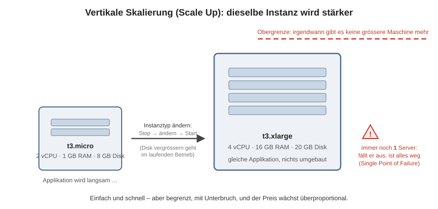
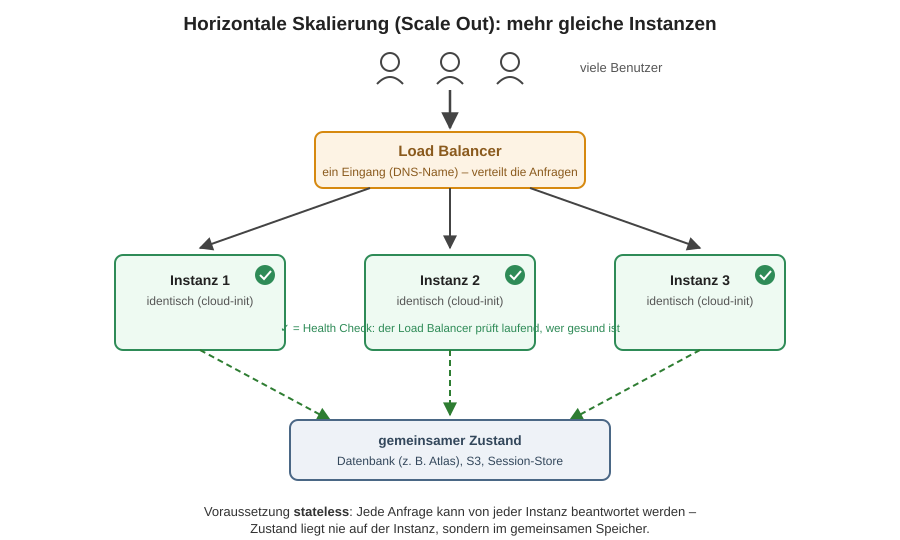
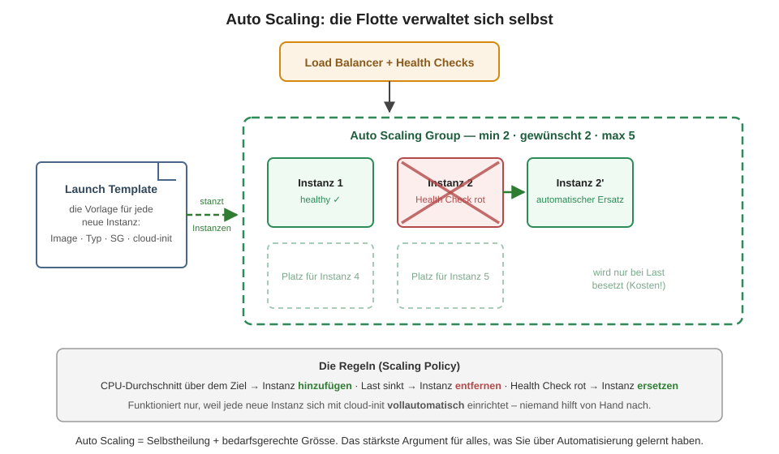

# Skalierung

## Lernziele

- Sie können vertikale und horizontale Skalierung erklären und mit Beispielen ausführen.
- Sie können für ein gegebenes Szenario begründen, welche Skalierungsart passt.
- Sie verstehen die Rolle von Load Balancer, Health Checks und Auto Scaling.
- Sie wissen, welche Voraussetzungen eine Applikation für horizontale Skalierung erfüllen muss.

## Das Problem

Ihre Applikation läuft auf einer Instanz. Die Benutzerzahlen wachsen, die Antwortzeiten steigen. Zwei grundsätzliche Auswege: die Instanz **stärker** machen (vertikal) oder **mehr** Instanzen (horizontal).

## Vertikale Skalierung (Scale Up)

Sie erhöhen die Ressourcen der bestehenden Instanz: mehr RAM, mehr CPUs, mehr Speicherplatz. Beispiel AWS: von `t3.micro` auf `t3.large` wechseln.

Ob das im laufenden Betrieb («hot») geht, hängt vom System ab: VMware unterstützt Hot-Add von CPU und RAM; bei Public-Cloud-Anbietern muss die Instanz für einen Typwechsel **gestoppt** werden (u. a. weil pro Instanztyp abgerechnet wird). Der **Datenspeicher** lässt sich dagegen auch bei AWS im laufenden Betrieb vergrössern.

Vorteile: einfach, keine Änderung an der Applikation nötig. Grenzen:

1. **Es gibt eine Obergrenze** – irgendwann existiert keine grössere Maschine mehr.
2. **Downtime** beim Umstellen (Stop → Typ ändern → Start).
3. **Keine Ausfallsicherheit** – es bleibt eine einzige Instanz (Single Point of Failure).
4. Der Preis wächst überproportional: Die doppelte Leistung kostet oft mehr als das Doppelte.

## Horizontale Skalierung (Scale Out)

Sie verändern die Instanz nicht, sondern fügen **weitere gleiche** Instanzen hinzu und verteilen die Last. Das ist dasselbe Prinzip wie beim Hyperscaler: viele Maschinen erscheinen nach aussen als eine Einheit.

Vorteile: praktisch unbegrenzt skalierbar, keine Downtime beim Hinzufügen, eingebaute Ausfallsicherheit (fällt eine Instanz aus, übernehmen die anderen). Der Preis: **die Architektur muss mitspielen.**

**Voraussetzung Zustandslosigkeit (stateless):** Jede Anfrage kann von jeder Instanz beantwortet werden. Das heisst: keine Benutzer-Sessions im lokalen RAM, keine Uploads auf der lokalen Disk – Zustand gehört in gemeinsame Dienste (Datenbank, S3, zentraler Session-Store). Deshalb nutzt die Applikation in KN07 eine externe Datenbank (MongoDB Atlas): Die Webinstanzen sind austauschbar.

## Load Balancer

Der Load Balancer ist der Eingangspunkt vor den Instanzen und verteilt die Anfragen. Im einfachsten Fall reihum (Round Robin), intelligentere Varianten berücksichtigen die Auslastung. Zwei Konsequenzen:

1. Die Benutzer sprechen nur noch den Load Balancer an – er hat einen **DNS-Namen** (z. B. `xyz.elb.amazonaws.com`) statt einer IP. Öffentliche IPs der einzelnen Instanzen braucht es nicht mehr; die eigene Domain zeigt per CNAME/Alias auf den Load-Balancer-Namen.
2. **Health Checks:** Der Load Balancer prüft periodisch (z. B. HTTP-Anfrage auf `/`), ob jede Instanz gesund ist. Ungesunde Instanzen bekommen keinen Traffic mehr. Ohne funktionierende Health Checks funktioniert weder Load Balancing noch Auto Scaling – in KN07 ist «Health Check grün» darum die Voraussetzung für alles Weitere.

## Auto Scaling

Auto Scaling fügt automatisch Instanzen hinzu oder entfernt sie, abhängig von der Last oder vom Zustand. Sie definieren: ein **Launch Template** (wie sieht eine neue Instanz aus – Image, Typ, cloud-init), eine **Zielgrösse** sowie Minimum/Maximum (z. B. Ziel 2, max. 5) und Regeln (z. B. CPU über 70 % → +1 Instanz).

Der Autoscaler ersetzt auch ausgefallene Instanzen: Fährt man eine Instanz von Hand herunter, startet er eine neue – das System «heilt sich selbst». Das funktioniert nur, weil die Installation vollautomatisch ist (cloud-init): Niemand kann bei einer automatisch erstellten Instanz von Hand nachhelfen. **Auto Scaling ist damit das stärkste Argument für alles, was Sie in diesem Modul über Automatisierung lernen.**

## Wann vertikal, wann horizontal?

| Situation | Empfehlung | Begründung |
|---|---|---|
| Datenbankserver braucht mehr RAM | vertikal | klassische SQL-DBs skalieren schlecht horizontal (siehe M165) |
| Webshop mit Lastspitzen (Black Friday) | horizontal + Auto Scaling | Spitzen abfangen, danach automatisch zurückbauen und Kosten sparen |
| Legacy-Applikation, die Sessions lokal speichert | (erstmal nur) vertikal | nicht stateless – horizontal würde Benutzer zufällig ausloggen |
| Hochverfügbarkeit gefordert | horizontal | mindestens 2 Instanzen, kein Single Point of Failure |
| Schnelle, einmalige Abhilfe bei Ressourcenmangel | vertikal | ein Typwechsel ist in Minuten erledigt |

In der Praxis kombiniert man: vertikal bis zum sinnvollen Kostenpunkt, horizontal für Last und Verfügbarkeit.

## Selbsttest

1. Warum muss eine Applikation «stateless» sein, um horizontal zu skalieren? Was passiert sonst konkret mit einem eingeloggten Benutzer?

Der Load Balancer kann jede Anfrage an eine andere Instanz schicken. Liegt die Session nur im RAM von Instanz A, ist der Benutzer ausgeloggt, sobald seine nächste Anfrage bei Instanz B landet. Lösung: Sessions in einen gemeinsamen Store (DB, Redis) auslagern.

2. Ihr Autoscaler soll defekte Instanzen ersetzen. Warum ist das ohne cloud-init (oder ähnliche Automatisierung) wertlos?

Die Ersatzinstanz startet vom rohen Image. Ohne automatische Installation läuft darauf keine Applikation – der Health Check bleibt rot, der Autoscaler ersetzt sie erneut, endlos. Automatische Skalierung setzt vollautomatische Installation voraus.

3. Vertikale Skalierung einer EC2-Instanz: Was geht im laufenden Betrieb, was nicht – und warum?

Disk vergrössern geht hot. CPU/RAM (= Instanztyp) erfordert Stop → ändern → Start, u. a. wegen der typbasierten Verrechnung und der Ressourcen-Neuplatzierung auf der physischen Hardware.

4. Der Load Balancer hat einen DNS-Namen statt einer IP. Wie bringen Sie Ihre Domain app.firma.ch dazu, darauf zu zeigen?

Mit einem CNAME-Eintrag (bzw. Alias-Record), der app.firma.ch auf den Load-Balancer-Namen (xyz.elb.amazonaws.com) auflöst. Ein A-Record auf eine IP wäre falsch, weil sich die IPs des Load Balancers ändern können.

## Quellen

- missioncloud.com: [Horizontal vs. Vertical Scaling](https://www.missioncloud.com/blog/horizontal-vs-vertical-scaling-which-is-right-for-your-app)
- aws.amazon.com: [What Is Load Balancing?](https://aws.amazon.com/what-is/load-balancing/)
