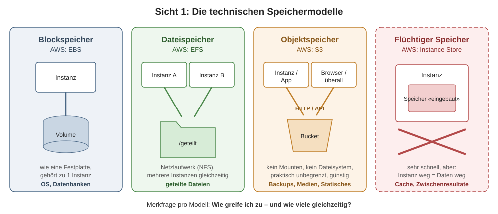
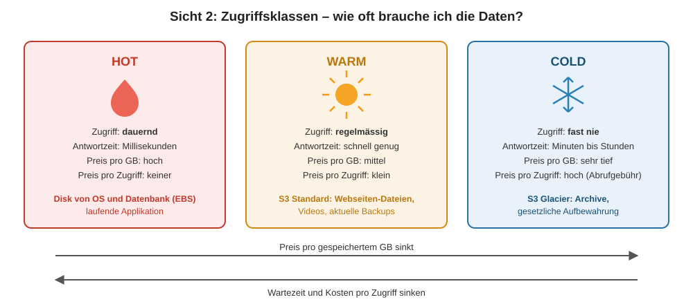
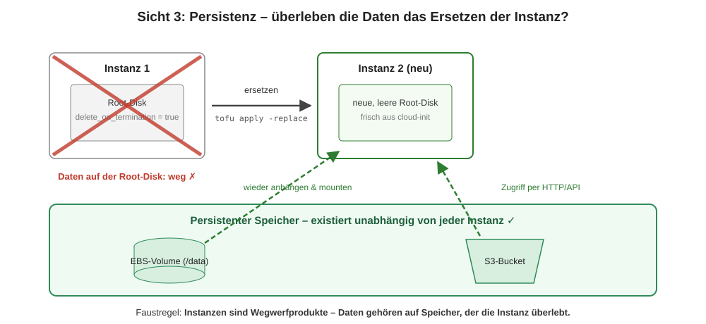

# Speichermodelle

## Lernziele

- Sie kennen die technischen Speichermodelle (Block-, Datei-, Objektspeicher, flüchtiger Speicher) und typische Einsatzzwecke.
- Sie kennen die Zugriffsklassen Hot, Warm und Cold und können Anwendungsfälle zuordnen.
- Sie können den Unterschied zwischen persistentem und flüchtigem Speicher erklären – speziell im Zusammenhang mit virtuellen Instanzen.
- Sie kennen die Unterschiede bei Lese-/Schreibgeschwindigkeit und Kosten der Modelle.

## Drei Sichtweisen auf Speicher

Speicher lässt sich auf drei Arten betrachten, die oft vermischt werden: **Wie** wird gespeichert (technisches Modell), **wie oft** wird zugegriffen (Zugriffsklasse), und **überleben die Daten die Instanz** (Persistenz)? Für eine gute Speicher-Entscheidung braucht es alle drei Sichten.

## Sicht 1: Die technischen Speichermodelle

**Blockspeicher (Block Storage).** Speicher wird als rohe Blöcke bereitgestellt – wie eine Festplatte. Das Betriebssystem formatiert ihn mit einem Dateisystem. Schnell, aber immer nur an **eine** Instanz gleichzeitig angehängt. Cloud-Beispiel: AWS EBS (Elastic Block Store) – die «Disk» Ihrer EC2-Instanz. Einsatz: Betriebssystem, Datenbanken.

**Dateispeicher (File Storage).** Ein fertiges Dateisystem mit Ordnerstruktur, das **mehrere** Systeme gleichzeitig einbinden können (wie ein Netzlaufwerk, NFS/SMB). Cloud-Beispiel: AWS EFS. Einsatz: geteilte Dateien zwischen mehreren Servern.

**Objektspeicher (Object Storage).** Dateien werden als Objekte mit eindeutigem Schlüssel in «Buckets» abgelegt und per HTTP/API angesprochen – kein Dateisystem, kein Mounten. Praktisch unbegrenzt skalierbar und sehr günstig, aber kein Ersatz für eine Disk (keine Teiländerungen an Dateien, höhere Latenz). Cloud-Beispiel: AWS S3. Einsatz: Backups, Bilder/Videos, statische Webseiten, Log-Archive.

**Flüchtiger Speicher (Ephemeral/Instance Storage).** Speicher, der direkt an die Lebensdauer der Instanz gebunden ist – Instanz weg, Daten weg. Dafür sehr schnell. Cloud-Beispiel: AWS Instance Store, temporäre Verzeichnisse. Einsatz: Caches, Zwischenresultate.

| Modell | AWS-Dienst | Zugriff | Mehrfachzugriff | Typischer Einsatz |
|---|---|---|---|---|
| Block | EBS | wie eine Disk (gemountet) | nein (1 Instanz) | OS, Datenbank |
| Datei | EFS | Netzlaufwerk (NFS) | ja | geteilte Dateien |
| Objekt | S3 | HTTP/API | ja | Backups, Medien, statische Sites |
| Flüchtig | Instance Store | wie eine Disk | nein | Cache, temporäre Daten |

## Sicht 2: Zugriffsklassen (Hot / Warm / Cold)

- **Hot Storage**: häufiger Zugriff, sehr kleine Verzögerung. Teuerste Klasse. Beispiel: die Disk, auf der OS und Datenbank laufen.
- **Warm Storage**: regelmässiger Zugriff, muss nicht Höchstleistung bieten (auch «Cool Storage» genannt). Beispiel: S3-Standardklasse für statische Dateien einer Webseite, gelegentlich abgespielte Videos.
- **Cold Storage**: sehr seltener Zugriff, darf langsam sein, dafür sehr günstig (auch «Archive Storage»). Zugriff kann Minuten bis Stunden dauern. Beispiel: S3 Glacier für Backups und Archive mit gesetzlicher Aufbewahrungspflicht.

Faustregel für die Kosten: **je heisser, desto teurer pro GB – je kälter, desto teurer pro Zugriff.** Cold Storage bestraft häufige Zugriffe mit Abrufgebühren und Wartezeit.

## Sicht 3: Persistenz – die wichtigste Eigenschaft in der Cloud

Persistent heisst: Die Daten überleben das Ende der Instanz, die sie geschrieben hat.

In der Cloud ist das nicht selbstverständlich – und das ist **gewollt**. Eine Cloud-Instanz gilt als Wegwerfprodukt: Bei Automatisierung (cloud-init, OpenTofu, Auto Scaling) wird eine Instanz nicht repariert, sondern **ersetzt**. Ein Betriebssystem wird deshalb kaum persistent gedacht – die nächste Instanz bekommt sowieso eine frische Installation. Applikationsdaten dagegen müssen die Instanz überleben und gehören darum auf persistenten Speicher, der **unabhängig von der Instanz** existiert: ein separates EBS-Volume, S3 oder eine externe Datenbank.

**Praxisbezug KN05:** Genau das erleben Sie im Kompetenznachweis: Datei auf der Root-Disk anlegen, Instanz per OpenTofu ersetzen – Datei weg. Dieselbe Datei auf einem separaten Volume oder in S3 – Datei überlebt.

## Selbsttest

1. Eine Web-Applikation speichert hochgeladene Profilbilder direkt auf der Root-Disk der EC2-Instanz. Der Autoscaler ersetzt die Instanz. Was passiert, und wie wäre es richtig?

Alle Bilder sind weg – die Root-Disk gehört zur Instanz. Richtig: Bilder in einen S3-Bucket (Objektspeicher) hochladen; der existiert unabhängig von jeder Instanz und ist von allen Instanzen hinter dem Load Balancer erreichbar.

2. Warum ist S3 kein Ersatz für die Disk einer Datenbank?

Objektspeicher wird per HTTP/API angesprochen, hat höhere Latenz und erlaubt keine effizienten Teiländerungen an Dateien. Eine Datenbank braucht schnellen, wahlfreien Blockzugriff – also Blockspeicher (EBS).

3. Ordnen Sie zu: tägliche DB-Backups der letzten 7 Tage vs. gesetzlich 10 Jahre aufzubewahrende Jahresabschlüsse.

Tägliche Backups: Warm (S3 Standard) – man braucht sie im Notfall schnell. Jahresabschlüsse: Cold (S3 Glacier) – Zugriff extrem selten, Wartezeit egal, Preis pro GB entscheidend.

4. Können mehrere EC2-Instanzen dasselbe EBS-Volume mounten, um Dateien zu teilen?

Grundsätzlich nein – Blockspeicher gehört zu einer Instanz. Für geteilten Dateizugriff ist Dateispeicher (EFS) oder Objektspeicher (S3) das richtige Modell.

## Quellen

- AWS: [Storage Services Übersicht](https://docs.aws.amazon.com/whitepapers/latest/aws-overview/storage-services.html)
- Microsoft: [Hot, cool and archive access tiers](https://learn.microsoft.com/en-us/azure/storage/blobs/access-tiers-overview)
- AWS: [Block vs. File vs. Object Storage](https://aws.amazon.com/compare/the-difference-between-block-file-object-storage/)
