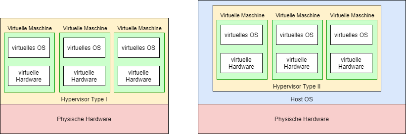
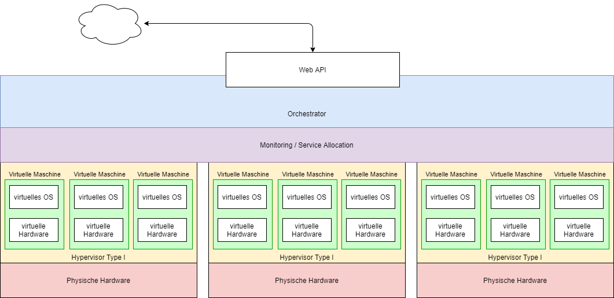

# Virtualisierung & Hypervisor

## Lernziele

- Sie können erklären, was Virtualisierung ist und welche Rolle ein Hypervisor spielt.
- Sie kennen den Unterschied zwischen Typ-1- und Typ-2-Hypervisoren und können für ein gegebenes Produkt begründen, welcher Typ vorliegt.
- Sie können erklären, warum ein Typ-2-Hypervisor mehr Ressourcen zuweisen kann, als physisch vorhanden sind (Overcommitment).
- Sie wissen, welches Backend Multipass je nach Betriebssystem verwendet (Hyper-V, VirtualBox, QEMU, früher HyperKit) und können die Technik dahinter einordnen.
- Sie können den Begriff Hyperscaler erklären und den Zusammenhang zur Virtualisierung herstellen.

## Was ist Virtualisierung?

Virtualisierung trennt das Betriebssystem und die Applikationen von der physischen Hardware. Ein **Hypervisor** ist die Software-Schicht, die das ermöglicht: Sie verwaltet die physischen Ressourcen (CPU, RAM, Disk, Netzwerk) und teilt sie mehreren **virtuellen Maschinen (VMs)** zu. Jede VM verhält sich wie ein eigenständiger Computer mit eigenem Betriebssystem – tatsächlich teilen sich alle VMs dieselbe Hardware.

Warum macht man das? Ein physischer Server ist ohne Virtualisierung meist zu 10–20 % ausgelastet. Mit Virtualisierung laufen 10, 50 oder 200 VMs auf derselben Maschine – die Hardware wird optimal genutzt, und VMs lassen sich in Sekunden erstellen, klonen, verschieben und löschen. Genau diese Eigenschaft macht Cloud Computing überhaupt erst möglich.

## Typ 1 vs. Typ 2

| | Typ 1 (native / bare metal) | Typ 2 (hosted) |
|---|---|---|
| Läuft auf | direkt auf der Hardware | als Applikation auf einem Betriebssystem |
| Performance | hoch (kein OS dazwischen) | tiefer (OS verwaltet den Hypervisor als Prozess) |
| Typischer Einsatz | Rechenzentren, Cloud-Anbieter | Entwickler-Laptops, Testumgebungen |
| Beispiele | VMware ESXi, Microsoft Hyper-V, KVM, Xen | VirtualBox, VMware Workstation/Fusion, Parallels, Multipass* |

*Multipass ist selbst kein Hypervisor, sondern eine Verwaltungsschicht: Welche Technik die VMs wirklich ausführt, hängt vom Betriebssystem ab (siehe nächster Abschnitt). Die Grenze zwischen Typ 1 und Typ 2 ist in der Praxis nicht immer scharf.

## Was steckt hinter Multipass?

Multipass startet und verwaltet VMs mit einem einzigen Befehl, überlässt die eigentliche Virtualisierung aber einem **Backend** (auch *Driver* genannt). Welches Backend bei Ihnen läuft, zeigt `multipass get local.driver`.

| Betriebssystem | Backend (`local.driver`) | Technik dahinter |
|---|---|---|
| Windows Pro / Education / Enterprise | `hyperv` | Microsoft Hyper-V (in Windows integriert) |
| Windows Home | `virtualbox` | Oracle VirtualBox (muss separat installiert werden) |
| Linux | `qemu` | QEMU, beschleunigt durch das Linux-Kernelmodul KVM |
| macOS, neuere Macs (Apple Silicon: M1 und neuer) | `qemu` | QEMU, beschleunigt durch Apples Hypervisor.framework |
| macOS, ältere Macs (Intel) | `hyperkit` (Multipass bis Version 1.12), bei neueren Versionen `qemu` | HyperKit bzw. QEMU |

**Was heisst das für Ihre Einordnung in KN01?** Ordnen Sie das Backend, das bei Ihnen läuft, mit den Kriterien aus der Tabelle oben (Typ 1 oder Typ 2) ein. Bei manchen Backends ist die Antwort nicht eindeutig – entscheidend ist Ihre Begründung.

## Warum kann Typ 2 mehr zuweisen, als vorhanden ist? (Overcommitment)

Das klingt zunächst unmöglich: Ein Laptop mit 8 logischen Prozessoren und 16 GB RAM lässt teilweise zu, einer VM 12 CPUs und 24 GB RAM zuzuweisen. Der Trick: Die Zuweisung ist ein **Versprechen, keine Reservation**.

**CPU – die Thread-Analogie:** Ein Betriebssystem führt ständig hunderte Threads «gleichzeitig» aus, obwohl nur wenige Kerne existieren. Die Threads laufen nicht wirklich parallel, sondern **abwechselnd in Zeitscheiben** – der Scheduler wechselt so schnell, dass es parallel wirkt. Virtuelle CPUs einer VM sind aus Sicht des Host-OS nichts anderes als Threads: 12 vCPUs auf 8 Kernen bedeutet, dass sich die vCPUs die Kerne zeitscheibenweise teilen. Es funktioniert – aber unter Volllast wird es langsam, weil gewartet werden muss.

**RAM – die Swap-Analogie:** Wenn der physische RAM nicht reicht, lagert das Betriebssystem selten genutzte Speicherseiten auf die Disk aus (Swap-Datei / Pagefile). Einer VM können so 24 GB «RAM» versprochen werden, von denen ein Teil in Wahrheit auf der (viel langsameren) Disk liegt. Auch hier: Es funktioniert, bis alle VMs ihren Speicher gleichzeitig wirklich brauchen – dann bricht die Performance ein (Thrashing).

Ein Typ-1-Hypervisor in einem Rechenzentrum betreibt Overcommitment übrigens auch – aber kontrolliert und überwacht. Der Unterschied bei Typ 2 ist, dass das darunterliegende Host-OS mit seinen eigenen Mechanismen (Scheduler, Swap) die Illusion erzeugt.

**Praxisbezug KN01:** Genau das testen Sie im Kompetenznachweis: Sie weisen einer VM mehr Ressourcen zu, als Ihr Host hat, und interpretieren, was passiert (Fehlermeldung = harte Grenze, Erfolg = Overcommitment).

## Hyperscaler

«Hyperscalers are large cloud service providers, that can provide services such as computing and storage at enterprise scale.» (redhat.com)

Ein Hyperscaler (AWS, Microsoft Azure, Google Cloud) nimmt das Hypervisor-Prinzip und vervielfacht es massiv: zehntausende physische Server, alle mit Typ-1-Hypervisoren, zusammengeschaltet zu einer Einheit, die nach aussen als «unendlicher» Ressourcenpool erscheint. Wenn Sie im Learner Lab eine EC2-Instanz starten, entscheidet AWS im Hintergrund, auf welchem physischen Server in welchem Rechenzentrum Ihre VM landet – für Sie ist das unsichtbar.

Das Grundprinzip ist bei allen grossen Anbietern gleich; die Details unterscheiden sich:

## Selbsttest

1. Ihr Kollege behauptet: «Docker ist auch ein Hypervisor.» Stimmt das?

Nein. Docker virtualisiert kein komplettes System mit eigenem Betriebssystem-Kernel, sondern isoliert Prozesse innerhalb desselben Kernels (Container). Ein Hypervisor betreibt vollständige Gast-Betriebssysteme.

2. Sie weisen auf Ihrem Laptop (8 logische CPUs) einer VirtualBox-VM 10 CPUs zu und die VM startet problemlos. Erklären Sie, wie das möglich ist.

VirtualBox ist ein Typ-2-Hypervisor. Die 10 vCPUs sind für das Host-OS gewöhnliche Threads, die per Zeitscheiben-Scheduling abwechselnd auf den 8 physischen Kernen laufen. Die VM «sieht» 10 CPUs, echte Parallelität gibt es aber nur bis 8.

3. Warum setzen Cloud-Anbieter ausschliesslich Typ-1-Hypervisoren ein?

Performance und Effizienz: Ohne Host-OS dazwischen gehen weniger Ressourcen verloren, die Isolation ist besser kontrollierbar, und die Hardware kann direkt und vollständig verwaltet werden – bei zehntausenden Servern zählt jedes Prozent.

4. Eine VM mit 24 GB zugewiesenem RAM auf einem 16-GB-Host wird plötzlich extrem langsam, sobald eine speicherintensive Applikation läuft. Was passiert technisch?

Der Host muss RAM-Inhalte in die Swap-Datei auf der Disk auslagern. Disk-Zugriffe sind um Grössenordnungen langsamer als RAM-Zugriffe – das System «thrashed» (lagert permanent aus und wieder ein).

## Quellen

- networkworld.com: [What is a hypervisor?](https://www.networkworld.com/article/3243262/what-is-a-hypervisor.html)
- redhat.com: [What is a Hyperscaler](https://www.redhat.com/en/topics/cloud/what-is-a-hyperscaler)
- Multipass-Dokumentation: [Driver](https://canonical.com/multipass/docs/stable/explanation/driver/) · [Migrate from Hyperkit to QEMU on macOS](https://canonical.com/multipass/docs/stable/how-to-guides/customise-multipass/migrate-from-hyperkit-to-qemu-on-macos/)
- Ubuntu Community Hub: [Announcing the first Release Candidate for Apple M1 support](https://discourse.ubuntu.com/t/announcing-the-first-release-candidate-for-apple-m1-support/24445) (QEMU mit Hypervisor.framework auf Apple Silicon)
