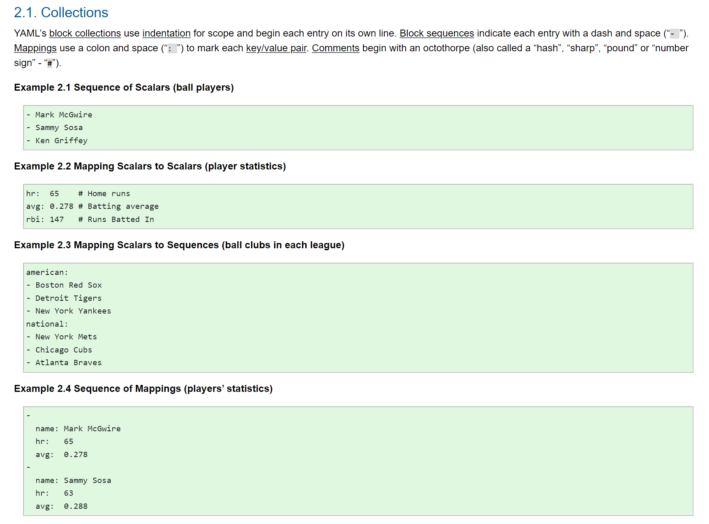

# YAML

## Lernziele

- Sie kennen die YAML-Grundelemente (Key-Value, Listen, Verschachtelung) und können sie lesen und schreiben.
- Sie kennen die typischen Fehlerquellen (Einrückung, Tabs, Anführungszeichen) und wissen, wie Sie YAML validieren.

## Warum YAML?

YAML («YAML Ain't Markup Language») ist ein Textformat für strukturierte Daten – wie JSON, aber auf Lesbarkeit für Menschen optimiert. Praktisch die gesamte Automatisierungswelt konfiguriert sich mit YAML: cloud-init, Ansible, Docker Compose, Kubernetes, GitLab CI. Wer YAML lesen kann, kann sich in all diesen Werkzeugen orientieren.

## Die Grundelemente

YAML kennt im Kern nur drei Bausteine, aus denen alles zusammengesetzt wird:

**1. Key-Value-Paare (Mappings):**

```yaml
name: webserver-01
port: 80
aktiv: true
```

**2. Listen (Sequences)** – jedes Element beginnt mit `- `:

```yaml
packages:
  - apache2
  - php
  - mariadb-server
```

**3. Verschachtelung** – durch **Einrückung** (konventionell 2 Leerzeichen). Die Einrückung ist nicht Kosmetik, sondern **Syntax** – sie definiert, was wozu gehört:

```yaml
users:
  - name: ubuntu                 # Element 1 der Liste "users": ein Objekt
    sudo: ALL=(ALL) NOPASSWD:ALL # gehört zum selben Objekt wie "name"
    shell: /bin/bash
  - name: admin                  # Element 2 der Liste
    shell: /bin/zsh
```

Zum Vergleich dieselbe Struktur als JSON – identischer Inhalt, YAML spart die Klammern:

```json
{"users": [{"name": "ubuntu", "sudo": "ALL=(ALL) NOPASSWD:ALL", "shell": "/bin/bash"}, {"name": "admin", "shell": "/bin/zsh"}]}
```



**Weitere nützliche Elemente:**

```yaml
# Kommentare beginnen mit #
beschreibung: "Text mit Sonderzeichen: gehört in Anführungszeichen"
mehrzeilig: |
  Dieser Block behält
  seine Zeilenumbrüche (z. B. für Datei-Inhalte oder Skripte).
leer: null
```

## Die klassischen Fehlerquellen

1. **Falsche Einrückung** – der Fehler Nummer 1. Ein Leerzeichen zu viel oder zu wenig ändert die Bedeutung oder macht die Datei ungültig. Konsequent 2 Leerzeichen pro Ebene verwenden.
2. **Tabs statt Leerzeichen** – Tabs sind in YAML **verboten**. Editoren so einstellen, dass Tab Leerzeichen einfügt (in VS Code Standard bei .yaml).
3. **Fehlender Leerschlag nach dem Doppelpunkt** – `port:80` ist ungültig, `port: 80` ist korrekt.
4. **Sonderzeichen ohne Anführungszeichen** – Werte mit `:`, `#`, `{`, `[` etc. in Anführungszeichen setzen.
5. **Das Ja/Nein-Problem**: unquotiertes `yes`, `no`, `on`, `off` wird (je nach Parser) als Boolean interpretiert. Das Länderkürzel für Norwegen als `country: NO` wird zu `false` – darum im Zweifel quoten: `country: "NO"`.

**Validieren statt raten:** <https://www.yamllint.com/> prüft die Syntax online. Bei cloud-init gilt: erst validieren, dann Instanz erstellen – das spart Debugging-Runden.

## Selbsttest

<details><summary>1. Finden Sie die zwei Fehler:</summary>

```yaml
packages:
- apache2
   - php
port:80
```

(1) Inkonsistente Einrückung der Liste – `- apache2` und `- php` müssen gleich weit eingerückt sein. (2) `port:80` – fehlender Leerschlag nach dem Doppelpunkt.
</details>

<details><summary>2. Wie unterscheidet sich in YAML eine Liste von Objekten von einem einzelnen Objekt mit mehreren Feldern?</summary>

Listenelemente beginnen mit `- `. Bei einer Liste von Objekten gehören alle Zeilen bis zum nächsten `- ` zum selben Objekt. Ohne `- ` sind es einfach mehrere Felder desselben Objekts.
</details>

<details><summary>3. Warum verbietet YAML Tabs?</summary>

Weil Tabs je nach Editor unterschiedlich breit dargestellt werden und die Einrückung in YAML Syntax ist – die Struktur wäre visuell nicht mehr eindeutig. Leerzeichen sind überall gleich breit.
</details>

## Quellen

- <https://yaml.org/> – offizielle Spezifikation
- spacelift.io: [YAML Tutorial](https://spacelift.io/blog/yaml)
- <https://www.yamllint.com/> – Online-Validator
