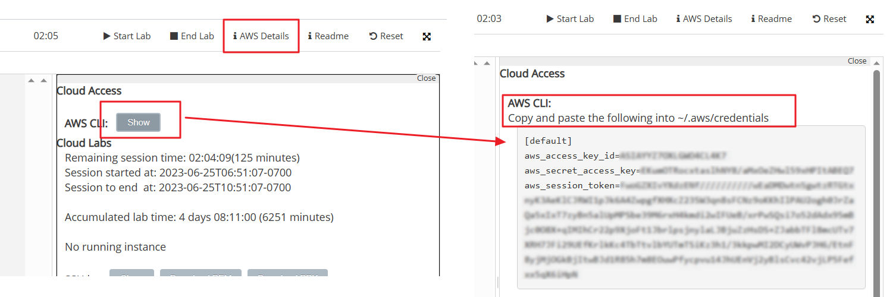

# AWS-Credentials im Learner Lab (Routine bei jedem Lab-Start)

Werkzeuge wie OpenTofu und die AWS-CLI melden sich mit **Zugangsdaten (Credentials)** bei AWS an. Die Besonderheit im Learner Lab: **Die Credentials ändern sich bei jedem Start des Labs.** Diese Routine führen Sie deshalb ab KN03 vor **jeder** Arbeitssession aus.

## Die Routine

1. Learner Lab starten und warten, bis der Kreis **grün** ist.
2. Auf **AWS Details** klicken → bei **AWS CLI** auf **Show**.
3. Es erscheint ein Block mit drei Werten: `aws_access_key_id`, `aws_secret_access_key` und `aws_session_token`.

4. Den **kompletten Block** kopieren und in die Datei `~/.aws/credentials` einfügen (bestehenden Inhalt ersetzen):
   - Windows: `C:\Users\<Sie>\.aws\credentials`
   - macOS/Linux: `~/.aws/credentials`

   Beim ersten Mal: Verzeichnis `.aws` und Datei `credentials` (ohne Endung!) von Hand erstellen.

5. Fertig – OpenTofu und AWS-CLI lesen diese Datei automatisch. Ihre Code-Dateien bleiben unverändert.

## Warum ändern sich die Credentials dauernd?

Das ist kein Ärgernis, sondern ein Sicherheitskonzept: Es sind **kurzlebige Session-Tokens**. Selbst wenn ein Token in falsche Hände gerät (geleaktes Repo, kopierter Bildschirm), ist es nach Ablauf der Session wertlos. Produktive Umgebungen arbeiten nach demselben Prinzip (temporäre Rollen statt Dauerpasswörter).

> **Sicherheits-Grundregel für das ganze Modul:** Credentials gehören **niemals** ins Git-Repository und niemals in Code-Dateien (auch nicht «nur zum Testen»). Die Datei `~/.aws/credentials` liegt bewusst ausserhalb Ihres Repos. Automatisierte Scanner durchsuchen GitHub und GitLab permanent nach geleakten AWS-Keys.

## Typische Fehler

- **`ExpiredToken` / `InvalidClientTokenId`:** Das Lab wurde neu gestartet, aber die Credentials nicht aktualisiert – Routine erneut ausführen.
- **`Unable to locate credentials`:** Datei am falschen Ort (`.aws` im Home-Verzeichnis?), falscher Dateiname (keine Endung), oder der Block wurde ohne die Kopfzeile `[default]` eingefügt.
- **Nur zwei Werte kopiert:** Der `aws_session_token` ist im Learner Lab **zwingend** – ohne ihn schlägt jede Anmeldung fehl.
